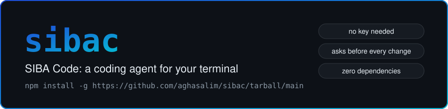
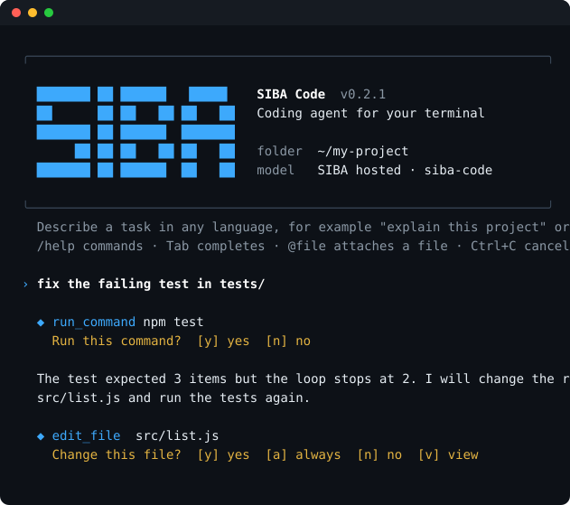
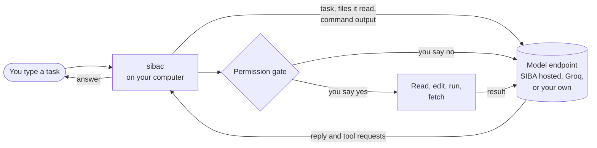
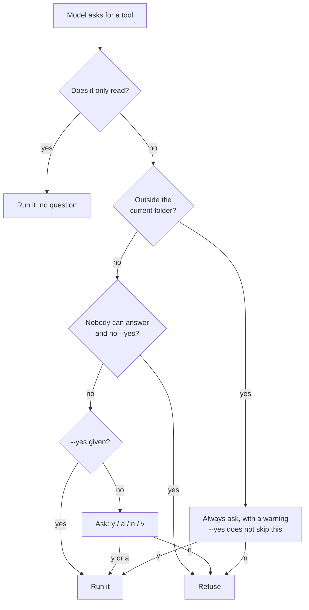
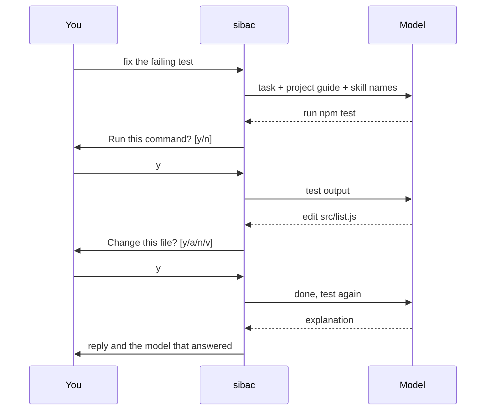

<p align="center"></p>

# sibac (SIBA Code)

A coding agent for your terminal, made by [SIBA](https://siba.az). Website and install line: [code.siba.az](https://code.siba.az). You describe a task; it reads your files, proposes changes and commands, and asks before it does any of them. No dependencies, Node.js only.

It works straight after install: with no settings it answers through SIBA's hosted line, free and without a key.

**Which model answers.** The hosted line (`siba-code`) runs open models, not a model trained by SIBA: at this release Qwen 3.8 27B first, and OpenAI's open-weight gpt-oss models when that one is busy, so the model can change from one reply to the next. The name of the model that really answered is printed under every reply. The one SIBA-trained model on offer is `siba-oak`, a small Azerbaijani model for plain chat: it cannot read or change files. You can also point sibac at Groq or any other OpenAI-compatible endpoint with your own key.

<p align="center"></p>

## How it works



The model only proposes; sibac does the work on your machine, and only after the gate lets it through.

## Install

One line, on Windows, macOS or Linux. It needs [Node.js](https://nodejs.org) 18 or newer and takes a few seconds:

```
npm install -g https://github.com/aghasalim/sibac/tarball/main
```

Then type `sibac` in any project folder. To try it once without installing:

```
npx -y https://github.com/aghasalim/sibac/tarball/main
```

With Homebrew (macOS, Linux):

```
brew tap aghasalim/siba
brew trust aghasalim/siba
brew install sibac
```

The `brew trust` line is for Homebrew 7 and newer, which asks before it uses a tap outside its own catalogue. Skip it on older versions.

`sibac update` prints the update command (the same install line). `sibac doctor` checks Node, the settings, the endpoint, git and the shell.

## First run

```
cd your-project
sibac
```

The first time, it shows a menu. Press Enter for the default:

```
  1) SIBA hosted   free, no key needed; runs open models (default)
  2) Groq          with my own key
  3) Another OpenAI-compatible endpoint
```

Choice 2 asks for the model (Enter keeps `openai/gpt-oss-120b`) and your key from https://console.groq.com/keys. Choice 3 asks for the endpoint address, the model and an optional key; a local Ollama is `http://localhost:11434/v1`. Every answer is checked and asked again if it cannot work. The key is not shown while you type it.

The answers are saved in `~/.sibac/config.json` on your computer. `/login` shows the menu again, `/logout` removes the key. If the saved endpoint is not a web address (version 0.1.0 accepted anything there), sibac says so at start and shows the menu instead of failing on every message.

`SIBAC_BASE_URL`, `SIBAC_MODEL` and `SIBAC_API_KEY` win over the file; `SIBAC_HOME` moves the `~/.sibac` folder. A SIBA key (`sk_siba_...`) for the hosted line goes in `SIBAC_API_KEY`, or in choice 3 with the address `https://siba.az/api/code/v1` and the model `siba-code`.

## Use

```
sibac                          # a session in the current folder
sibac -p "fix the failing test"    # one task, then exit (sibac "task" does the same)
sibac --continue               # reopen the latest conversation of this folder
sibac --model siba-oak         # another model for this run
sibac --yes -p "task"          # approve changes and commands inside this folder without asking
```

In a session:

| Type | What it does |
|---|---|
| `/help` | the commands and skills |
| `/model`, `/model <name>` | list the models, switch |
| `/login`, `/logout` | choose the model line again, remove the saved key |
| `/status` | endpoint, model, tokens used this session, folder, version |
| `/init` | looks at the project and writes `SIBAC.md` |
| `/skills`, `/<skill>` | list the skills, run one |
| `/resume` | reopen an earlier conversation from this folder |
| `/compact` | replace the conversation by a summary, to save tokens |
| `/diff` | `git status` and `git diff` of the folder |
| `/undo` | put back the files the last turn changed |
| `/clear`, `/exit` | start a new conversation, leave |

Tab completes commands and `@paths`; typing `/` lists the matching commands under the prompt. `@some/file` in a message attaches that file. The arrow keys recall earlier messages. Ctrl+C during a reply cancels that reply; at the prompt it empties the line, and pressed twice it leaves.

## What it asks permission for

| Action | Asks? |
|---|---|
| Read a file, list a folder, search or find files inside the current folder; show a task list; load a skill | No |
| Read, list or search outside the current folder, or in sibac's own settings and saved conversations (`~/.sibac`, which searches also skip) | Yes, every time, with a warning. `--yes` does not skip it |
| Create or change a file in the current folder | Yes: `y` once, `a` for the rest of the session, `n` no, `v` shows the whole change first |
| Change Git settings or hooks (`.git/`, `.gitattributes`, `.gitmodules`) | Yes, every time. `--yes` and "always" do not skip it, because git runs those files |
| Run a shell command | Yes, every time |
| Fetch a web address | Yes, every time. Only public http(s) addresses: local and private ones are refused |
| Change anything outside the current folder | Yes, every time, with a warning |



`--yes` approves file changes, commands and web fetches without asking. It never approves a read or change outside the current folder, or a change to Git settings or hooks. When nobody can answer (a script without `--yes`), every change, command and fetch is refused.

`/diff` runs git with hooks and the file-system monitor switched off, so a repository you did not write cannot run code through it.

`/undo` covers what the file tools wrote in the running session. It does not undo what a shell command did.

## A typical session



## Skills

A skill is a markdown file with instructions for one kind of task, in the common `SKILL.md` format: a folder with a `SKILL.md` whose frontmatter has `name` and `description`, or a single `name.md`. sibac ships five (`/review`, `/explain`, `/test`, `/fix`, `/commit`) and reads yours from:

- `.sibac/skills/` in the project
- `~/.sibac/skills/` for all projects
- `.claude/skills/` in the project, if it exists (read only)

Run one with `/<name> what you want`. The model can also load one on its own when the task fits; only names and one-line descriptions are sent with every request.

```
sibac skills                              # list them
sibac skills add owner/repo/path/to/skills    # install skill folders from a public GitHub repository
```

`skills add` downloads the repository archive, shows what it found and asks before it writes into `~/.sibac/skills`. It refuses archives with links or paths that leave their folder, and anything large (300 files, 1 MB a file, 8 MB in all). A skill is text the model will follow: read it before you rely on it.

## Project guide

If the folder has a `SIBAC.md` (or, without one, an `AGENTS.md`), its text is sent along as notes about the project: how to build and test, the layout, the conventions. `/init` writes one. It is treated as information, not as permission: it cannot approve anything.

## What is sent where

Your task, the files sibac reads, the output of the commands it runs, the skill list and the project guide go to the endpoint in use. On the hosted line that is SIBA's server at siba.az, which passes the request on to the provider that runs the open model. Do not use it in a folder with secrets you would not send there.

Conversations are saved as JSON in `~/.sibac/sessions/`, per folder, for `--continue` and `/resume`. They hold the messages (including file contents the agent read) and never the key. Delete the folder to forget them.

## Limits in 0.2.3

- The hosted line is free and shared. At this release: 10 requests a minute and 200 a day per address (60 a minute and 2,000 a day with a SIBA key), about 7,000 input tokens per request on the first model, replies up to 4,000 tokens. To fit, sibac keeps tool output and history short there, reads long files in pieces, and summarises the conversation once on its own when a request is too large. A short busy signal is waited out; at the daily cap it says so and stops. Large tasks go better with your own key.
- `siba-oak` is chat only: it sees only the last few turns, answers briefly, and is offline at times (it runs on a small server).
- A free Groq key allows only a few thousand tokens a minute per model, so long tasks pause on rate limits there too.
- Replies appear line by line as they arrive, not letter by letter.
- Commands run in bash (Git Bash on Windows, PowerShell if it is missing), with a 2 minute limit and no interactive input.
- `/undo` and the "always" answer last for the running session only.
- sibac needs a real terminal for the session. In an old Git Bash window (mintty) Node sees no terminal: use Windows Terminal, or `winpty sibac`.
- Colours use 24-bit codes where the terminal announces them (`COLORTERM`) and on Windows, 256 colours elsewhere; `NO_COLOR` switches colour and the start animation off.

## Development

```
node test.js        # offline checks of the tools, the permission gate and the parsers
node e2e.js         # drives the real program against a local stand-in endpoint
python3 e2e-pty.py  # the interactive paths in a real pseudo-terminal (Linux, macOS, WSL)
```

## License

MIT
