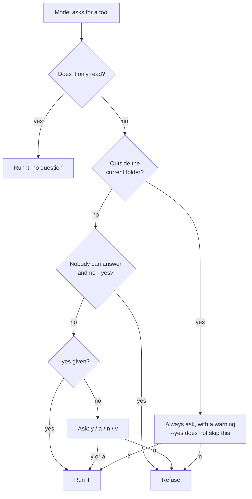

# What it asks permission for

| Action | Asks? |
|---|---|
| Read a file, list a folder, search or find files inside the current folder; show a task list; load a skill | No |
| Read, list or search outside the current folder, or in sibac's own settings and saved conversations (`~/.sibac`, which searches also skip) | Yes, every time, with a warning. `--yes` does not skip it |
| Create or change a file in the current folder | Yes: `y` once, `a` for the rest of the session, `n` no, `v` shows the whole change first |
| Change Git settings or hooks (`.git/`, `.gitattributes`, `.gitmodules`) | Yes, every time. `--yes` and "always" do not skip it, because git runs those files |
| Run a shell command | Yes, every time |
| Fetch a web address | Yes, every time. Only public http(s) addresses: local and private ones are refused |
| Change anything outside the current folder | Yes, every time, with a warning |

`--yes` approves file changes, commands and web fetches without asking. It never approves a read or change outside the current folder, or a change to Git settings or hooks. When nobody can answer (a script without `--yes`), every change, command and fetch is refused.

`/diff` runs git with hooks and the file-system monitor switched off, so a repository you did not write cannot run code through it.

`/undo` covers what the file tools wrote in the running session. It does not undo what a shell command did.
